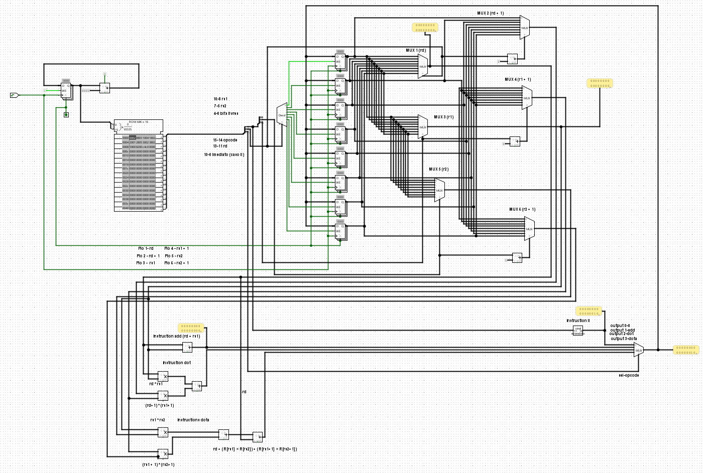

# Mini-Transformer em RISC-V — Projeto de IAC

Projeto da unidade curricular de **Introdução à Arquitetura de Computadores (IAC)**, 2025/2026, da Licenciatura em Engenharia Informática e de Computadores (LEIC) no Instituto Superior Técnico.

O tema do projeto é um **Mini-Transformer**, um "ChatGPT simplificado": um pequeno modelo que, dada uma frase, prevê a palavra seguinte usando a ideia central do mecanismo de **atenção** (*attention*) dos Transformers. O trabalho foi dividido em três partes, que vão do software até ao hardware:

| Parte | Tema | Ferramenta |
|-------|------|------------|
| Projeto 1 | Funções base sobre vetores (`select`, `argmax`, `dot`) | Assembly RISC-V (Ripes) |
| Projeto 2 | Pipeline completa do Mini-Transformer | Assembly RISC-V (Ripes) |
| Projeto 3 | Processador de 16 bits com instruções de produto interno | Logisim |

---

## Como funciona o Mini-Transformer

1. A frase é dividida em **tokens** (palavras), e cada token é convertido num índice do vocabulário.
2. Cada índice é convertido num vetor (**embedding**), o que forma a matriz `E`.
3. São calculadas três representações: `Q = E × W_Q`, `K = E × W_K` e `V = E × W_V`.
4. Para a última palavra da frase, calcula-se a relevância de cada palavra com `score(i, j) = Q_i · K_j`.
5. Com `argmax` escolhe-se a palavra mais relevante e vai-se buscar o vetor `V` correspondente.
6. Esse vetor é comparado com os embeddings do vocabulário, e a palavra mais semelhante é a **previsão do próximo token**.

---

## Projeto 1 — Primeiros módulos

Implementação em Assembly RISC-V (com a extensão M) das operações fundamentais do modelo, cada uma num programa autónomo:

- **`select.s`**: devolve o elemento de um vetor num dado índice, com validação do tamanho e dos limites do índice.
- **`argmax.s`**: devolve o índice do maior elemento de um vetor (em caso de empate, o menor índice).
- **`dot.s`**: calcula o produto interno entre dois vetores de inteiros.

Todas as funções devolvem um código de estado em `a0` (sucesso, argumento inválido, índice fora dos limites, etc.) e o resultado em `a1`.

## Projeto 2 — Compor a rede neuronal

Construção da pipeline completa do Mini-Transformer em RISC-V (`p2-template_2.1.s`), reutilizando as funções do Projeto 1:

- leitura de ficheiros (vocabulário, frase de entrada, matrizes `W_Q`, `W_K`, `W_V` e embeddings) através de *syscalls*;
- *parsing* de matrizes de inteiros a partir de texto;
- conversão de tokens em índices e construção da matriz de embeddings da entrada;
- multiplicação de matrizes para obter `Q`, `K` e `V`;
- cálculo dos *scores* de atenção, seleção do token mais relevante e decisão do próximo token.

## Projeto 3 — Processador de 16 bits com aceleração DOT

Processador **single-cycle** de 16 bits construído em Logisim, especializado nas operações do Mini-Transformer. Em vez de calcular produtos internos com ciclos em software, o processador faz essas contas diretamente em hardware.

### Organização

- **ROM** com o programa, endereçada pelo **PC**, que incrementa 1 em cada ciclo.
- **Banco de 8 registos** de 16 bits (`R0`–`R7`).
- **Descodificador** e multiplexers que selecionam os registos `rd`, `rd+1`, `rs1`, `rs1+1`, `rs2` e `rs2+1`.
- **ALU** com multiplicadores e somadores em paralelo para `dot` e `dota` (resultado truncado a 16 bits).
- Extensão de sinal do imediato de 11 bits para a instrução `li`.
